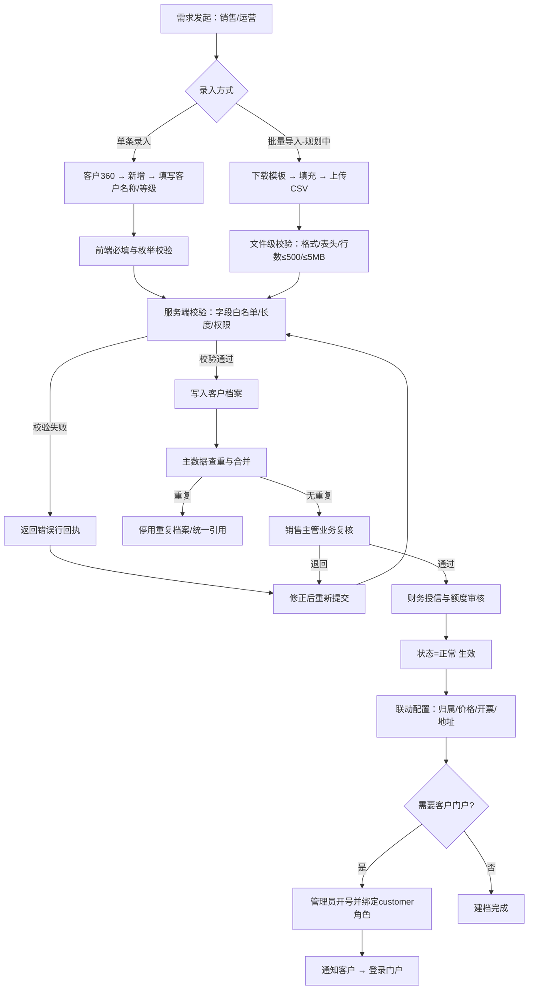

# PMP 制造协同平台 · 角色权限与客户导入操作手册

| 项目 | 内容 |
| --- | --- |
| 文档版本 | V1.0 |
| 适用系统 | PMP 制造协同平台（Vue3 + Spring Boot 3.3.5） |
| 适用版本 | 页面 70 个业务页 + 5 个系统管理页，15 个菜单分组，17 个内置角色 |
| 访问地址 | http://192.168.102.242:8080 |
| 适用对象 | 各角色业务用户、销售/运营、主数据管理员、系统管理员 |
| 编写依据 | 前端 `pages.json` / `config.ts`、后端 `V2__rbac_seed.sql`、`BizCrudService`、`AuthService`、`SystemUserController` 等实际代码 |

> 本手册所有功能描述均以当前已上线代码为准。凡是当前版本未实现的能力，均在文中明确标注「当前版本不支持 / 规划中」，并给出可执行的替代做法，避免按文档操作却找不到按钮。

---

## 0. 通用规则（所有角色必读）

### 0.1 登录与会话

| 项目 | 规则 |
| --- | --- |
| 登录地址 | http://192.168.102.242:8080，未登录自动跳转 `/login` |
| 登录凭证 | 账号 + 密码，账号全局唯一、创建后不可修改 |
| 访问令牌 | Access Token 有效期 2 小时，到期前自动静默刷新 |
| 刷新令牌 | Refresh Token 有效期 7 天，超期需重新登录 |
| 单会话策略 | 同一账号在新设备登录后，旧会话立即失效（旧页面下一次请求返回 401，需重新登录） |
| 密码错误锁定 | 15 分钟窗口内累计错误 5 次，账号锁定 30 分钟，登录提示「账号已锁定，请于 HH:mm 后重试」 |
| 账号停用 | 管理员停用账号后，该账号在线会话立即被踢出且禁止登录 |
| 权限变更生效 | 角色菜单权限保存后，该角色下在线账号会被强制重新登录，重新登录后权限生效 |
| 登出 | 右上角头像 → 退出登录，服务端同步清理会话 |

### 0.2 通用列表页（59 个业务列表页共用同一套交互）

所有列表页（`CrudPage`）提供的标准能力完全一致：

| 能力 | 说明与限制 |
| --- | --- |
| 分页 | 每页 10 / 20 / 50 / 100 条，支持页码跳转；服务端单页上限 200 条 |
| 关键字搜索 | 输入关键字后回车或点「查询」，对单号 `code` + 该页前若干业务列做模糊匹配 |
| 精确筛选 | 筛选条件按字段精确匹配；日期区间按创建时间过滤（含起始日，不含结束日次日） |
| 新增 | 弹窗表单，必填项带红色星号，未填时提示「请填写 XXX」 |
| 编辑 | 弹窗回填当前行，保存时携带版本号做乐观锁校验 |
| 删除 | 软删除（标记 `deleted=1`），列表不再显示，详情返回「数据不存在或无权查看」 |
| 批量删除 | 勾选后点击「批量删除（N）」，单次最多 500 条，超限提示「单次最多删除 500 条」 |
| 导出 | 导出 CSV（UTF-8 带 BOM，Excel 可直接打开），单次最多 50 000 行 |
| 详情 | 右侧抽屉展示全部字段 + 创建人、创建时间、更新时间 |
| 编码生成 | `code` 留空时自动生成，格式为「页面首字母-YYYYMMDD-4 位随机数」，如 `C-20261112-3821` |
| 冲突提示 | 两人同时编辑同一行，后保存者收到「数据已被他人修改或无权操作，请刷新后重试」（409） |
| 字段长度 | 业务字段最长 255 字符，`code` 最长 64 字符，超长会保存失败 |
| 字段白名单 | 提交未定义的字段会被服务端拒绝（400「非法字段」） |

### 0.3 权限模型

系统采用 **RBAC（角色-菜单-页面）+ 数据范围** 双层控制：

1. **菜单可见性**：用户被授予哪些页面菜单，就只能看到哪些菜单和路由；未授权页面的路由不会注册，直接输入地址会进入 404 页面；接口层无权限返回 403。
2. **数据范围**：在页面可见的基础上，列表/详情/导出再按角色数据范围过滤。
3. **按钮权限**：权限码规范为 `biz:<页面ID>:<动作>`，动作为 `list / create / update / delete / export`。

| 数据范围 | 语义 | 实际过滤条件 |
| --- | --- | --- |
| ALL | 全量数据 | 不过滤，可看所有部门数据 |
| DEPT | 仅本部门 | `dept_id = 当前用户部门` |
| DEPT_AND_CHILD | 本部门及下级 | 本部门 + `sys_dept.ancestors` 包含本部门的子部门 |
| CUSTOM | 指定部门 | `sys_role_dept` 中该角色被授权的部门集合 |
| SELF | 仅本人 | `created_by = 当前登录账号`（外部供应商/客户专用） |

> 一个用户绑定多个角色时，数据范围按「最大范围」合并（ALL > DEPT_AND_CHILD > DEPT > CUSTOM > SELF）。

**重要说明（当前版本的真实边界）**：按钮权限按「页面」粒度下发——角色一旦被授予某页面的 `:list`，系统会自动补齐该页面的 `create / update / delete / export` 权限。也就是说，**能看见页面就具备该页面的新增、编辑、删除、导出能力**。因此「只读角色」（如审计员）属于**制度约束 + 审计追溯**，不是硬性技术只读。需要严格只读时，应由管理员不给该角色授予对应业务页面。

### 0.4 内置演示账号

| 账号 | 姓名 | 部门 | 角色 | 初始密码 | 说明 |
| --- | --- | --- | --- | --- | --- |
| admin | 系统管理员 | PMP 集团 | admin | Admin@123 | 全部权限 |
| exec | 高管演示 | PMP 集团 | exec | Demo@123 | 全量数据只读 |
| audit | 审计演示 | PMP 集团 | audit | Demo@123 | 全量数据核查 |
| rd | 研发演示 | 研发中心 | rd | Demo@123 | |
| prod | 生产主管演示 | 制造中心 | prod | Demo@123 | |
| fin | 财务演示 | 财务中心 | fin | Demo@123 | |
| planner | 计划员演示 | 供应链中心 | planner | Demo@123 | |
| buyer | 采购员演示 | 供应链中心 | buyer | Demo@123 | |
| wh | 仓管员演示 | 供应链中心 | wh | Demo@123 | |
| sales | 销售演示 | 供应链中心 | sales | Demo@123 | |
| mdm | 主数据演示 | 供应链中心 | mdm | Demo@123 | |

> **没有演示账号的角色**：supplier（供应商）、customer（客户）、qc（质量员）、logi（物流调度）、data（数据管理员）、sre（运维工程师）。这 6 个角色必须由管理员在「系统管理 → 用户管理」中新建账号并绑定对应角色后才能使用。
>
> **演示数据可见性提示**：初始化演示数据归属「PMP 集团（dept_id=1）」，而 planner / buyer / wh / sales / mdm 演示账号属于「供应链中心（dept_id=3）」，受 DEPT 范围限制，这些账号登录后业务列表可能为空。处理方式见各角色 FAQ 与 4.4 节第 8 项。

---

## 1. 角色总览

| # | 角色编码 | 角色名称 | 数据范围 | 业务页面数 | 核心定位 |
| --- | --- | --- | --- | --- | --- |
| 1 | exec | 高管 | ALL | 8 | 经营看板、S&OP 决策、成本与应收风险 |
| 2 | planner | 计划员 | DEPT | 21 | 预测、S&OP、主生产、补货、产能 |
| 3 | buyer | 采购员 | DEPT | 13 | 供应商、寻源、采购订单、对账 |
| 4 | supplier | 供应商 | SELF | 4 | 外部协同：订单确认、ASN、对账 |
| 5 | customer | 客户 | SELF | 1 | 外部门户：订单、物流、对账、售后 |
| 6 | rd | 研发工程师 | DEPT | 5 | 物料申请、BOM、工艺、ECN、图纸 |
| 7 | prod | 生产主管 | DEPT | 13 | 工单、报工、现场异常、设备、成本 |
| 8 | qc | 质量员 | DEPT | 13 | 检验、不良、批次追溯、供应商质量 |
| 9 | wh | 仓管员 | DEPT | 13 | 收货、上架、拣货、发货、盘点 |
| 10 | logi | 物流调度 | DEPT | 6 | 运输任务、承运商、在途、运费 |
| 11 | sales | 销售客服 | DEPT | 17 | 客户、订单、发货、售后、开票协同 |
| 12 | fin | 财务 | DEPT | 24 | 应收应付、发票结算、成本、信用 |
| 13 | data | 数据管理员 | ALL | 11 | 指标、报表、数据质量、集成与调度 |
| 14 | mdm | 主数据管理员 | DEPT | 9 | 物料/供应商/客户/仓库主数据 |
| 15 | admin | 系统管理员 | ALL | 62 + 5 系统页 | 全页面、账号、权限、菜单、字典 |
| 16 | sre | 运维工程师 | DEPT | 11 | CI/CD、监控、配置密钥、网关与资源 |
| 17 | audit | 审计员 | ALL | 12 + 2 系统页 | 审计日志、合规核查 |

> 业务页面数**不含**以下 8 个全角色通用页面：我的工作台、待办中心、消息中心、流程中心、文件中心、全局搜索、个人中心、异常提示页。这 8 个页面所有角色（含供应商、客户）均可访问。

---

## 2. 分角色操作说明

### 2.1 高管（exec）

**① 角色定位与专属场景**

面向公司级经营决策者。用于每日经营驾驶舱晨会、月度经营分析会、S&OP 决策会、应收与成本风险跟踪、资源投入评审。以「看数、决策、督办」为主，不承担明细录入。

**② 系统访问范围（8 个业务页面）**

| 模块 | 页面 | 用途 |
| --- | --- | --- |
| 工作台 | 经营驾驶舱 | 营收、订单、交付、库存、质量等核心 KPI 与趋势 |
| 计划 | 需求预测 | 查看需求预测结论与偏差 |
| 计划 | S&OP 会议 | 查看产销存平衡结论与决策事项 |
| 财务协同 | 应收应付 | 应收账龄、逾期风险、应付压力 |
| 财务协同 | 成本核算 | 产品/订单成本与毛利 |
| 数据 | 指标平台 | 统一指标口径查询 |
| 数据 | 自助报表 | 自助取数与多维分析 |
| 运维管控 | 资源与成本 | IT 资源投入与成本 |

**③ 标准日常操作流程（SOP）**

1. 登录 → 默认进入「我的工作台」，查看待办与预警摘要。
2. 进入「经营驾驶舱」，按日/周查看 KPI 卡与趋势图，记录异常指标。
3. 进入「待办中心」，处理需高管审批的事项（审批动作在流程中心/业务页完成）。
4. 经营分析会前，用「指标平台」「自助报表」导出所需口径数据（单次 ≤5 万行）。
5. S&OP 会议前查看「需求预测」「S&OP 会议」，确认产销存平衡结论。
6. 查看「应收应付」账龄与逾期、「成本核算」毛利，形成督办意见。
7. 将督办事项通过待办/消息分派给对应负责人，闭环跟踪。

**④ 操作边界限制**

- 数据范围 ALL，可查看全部门数据，但仅限上述 8 个页面，看不到采购执行、生产工单、仓储作业等明细页面。
- 具备页面级增删改能力（技术上限），但按制度应仅做只读与审批，不直接修改业务台账。
- 导出上限 5 万行；导出文件含金额与客户信息，禁止外发。

**⑤ 权限隔离规则**

- 与业务角色为「看汇总、不看明细」的隔离关系：需要明细时由 planner / sales / fin 提供导出。
- 与 admin 隔离：高管不具备账号、权限、菜单配置能力。
- 导出行为会记录在操作日志中，供审计追溯。

**⑥ 注意事项**

- 驾驶舱为聚合视图，与明细列表口径可能存在差异（聚合口径 vs 明细台账），以指标平台口径说明为准。
- 单会话登录：在会议室大屏登录会踢掉本人电脑会话。
- 账号密码请通过管理员重置，当前版本个人中心不提供自助改密。

**⑦ 常见问题**

| 现象 | 原因 | 处理 |
| --- | --- | --- |
| 看不到采购/生产/仓储菜单 | 未授予对应页面 | 属正常权限设计；需明细请向对应角色索取 |
| 驾驶舱数字与明细页不一致 | 聚合口径与明细口径不同 | 以「指标平台」的指标定义为准，或联系 data 角色核对 |
| 导出 CSV 打开乱码 | 用记事本/非 Excel 工具打开 | 使用 Excel「数据 → 自文本/CSV」，编码选 UTF-8 |
| 提示「账号已锁定」 | 15 分钟内密码错误 5 次 | 等待 30 分钟，或联系 admin 重置密码/解锁 |
| 被强制退出 | 同一账号在别处登录 | 单会话策略，确认无他人使用后重新登录 |

---

### 2.2 计划员（planner）

**① 角色定位与专属场景**

负责需求预测、产销平衡、主生产计划、物料补货与产能平衡。专属场景：月度 S&OP 准备、周度主生产计划下达、缺料预警与补货、产能瓶颈协调、订单交付评审。

**② 系统访问范围（21 个业务页面）**

- 工作台：经营驾驶舱
- 研发协同：物料申请、BOM 管理、ECN 工程变更
- 计划：需求预测、S&OP 会议、主生产计划、补货计划、产能平衡
- 采购：采购申请
- 生产：工单管理、报工管理、安灯异常、设备管理
- 仓储：库存管理
- 履约：订单池、订单审核与分单
- 客户：销售订单
- 数据：指标平台、自助报表
- 公共能力：规则引擎

**③ 标准日常操作流程（SOP）**

1. 登录 → 工作台查看待办与预警。
2. 「需求预测」：核对预测版本与偏差，确认本期预测基线。
3. 「S&OP 会议」：维护会议议题与产销存平衡结论，输出决策事项。
4. 「主生产计划」：按预测与订单生成/调整 MPS，确认开工与完工日期。
5. 「产能平衡」：核对瓶颈工序负荷，超负荷时提出委外/加班/调序建议。
6. 「补货计划」：按安全库存与在途计算缺口，形成补货建议。
7. 缺口转「采购申请」，提交给 buyer 执行；紧急缺料在待办中说明原因与需求日期。
8. 跟踪「工单管理」「报工管理」进度，「安灯异常」「设备管理」处理影响交付的异常。
9. 「库存管理」核对可用/在途/锁定库存，「订单池」「订单审核与分单」参与交付评审。
10. 「销售订单」确认承诺交期；用「指标平台」「自助报表」输出计划达成率周报。

**④ 操作边界限制**

- 数据范围 DEPT：仅本部门（供应链中心）数据。研发（研发中心）、生产（制造中心）部门的记录默认不可见。
- 计划页面本质为计划台账维护，**不触发实际排程/ MRP 运算**，调整结果需线下同步生产与采购。
- 批量删除 ≤500 条；导出 ≤5 万行；删除为软删除，可追溯但不可在界面恢复。
- 字段均为文本型（含数量、金额），录入时需统一格式（纯数字、统一单位），否则无法用于计算。

**⑤ 权限隔离规则**

- 与 buyer：计划员可提交采购申请，但采购订单下达、供应商选择属 buyer 职责。
- 与 prod：计划员可看工单/报工，但派工、报工确认属 prod 职责。
- 与 sales：订单池/订单审核为协同页，销售负责客户侧，计划负责交付可行性。
- 与 mdm：BOM/物料主数据修改权限归 rd 与 mdm，计划员只读引用。

**⑥ 注意事项**

- **演示账号看不到数据**：planner 演示账号属「供应链中心（dept_id=3）」，而演示数据归属「PMP 集团（dept_id=1）」，DEPT 范围下列表为空。处理：admin 在用户管理中把账号部门改为 PMP 集团，或把数据 `dept_id` 调整到供应链中心（需数据管理员操作）。
- 修改计划后务必在待办/消息中通知下游，系统不会自动推送。
- 编码留空自动生成，建议关键计划单号统一人工编码规则，便于线下对齐。

**⑦ 常见问题**

| 现象 | 原因 | 处理 |
| --- | --- | --- |
| 列表为空但确实有数据 | DEPT 数据范围与数据归属部门不一致 | 核对账号部门与数据部门；联系 admin 调整部门 |
| 新增按钮灰色 | 该页面未授权或会话权限过期 | 重新登录；仍不行联系 admin 检查角色菜单 |
| 保存提示 409 | 他人已先修改 | 刷新列表后重新编辑 |
| 采购申请提交后 buyer 看不到 | 部门数据范围不同 | 由 buyer 在本部门范围查看，或调整数据归属 |
| 删除后想恢复 | 软删除无界面恢复入口 | 联系 DBA/运维按需恢复，需走变更流程 |

---

### 2.3 采购员（buyer）

**① 角色定位与专属场景**

负责供应商开发与准入、寻源询价、采购申请执行、采购订单下达、ASN 到货协同、三单匹配对账与发票结算协同。专属场景：询价比价、订单交期跟催、来料异常协同、月度对账。

**② 系统访问范围（13 个业务页面）**

- 计划：补货计划
- 采购：供应商管理、供应商门户、寻源询价、采购申请、采购订单、ASN 收货协同、三单匹配对账
- 生产：质量管理
- 仓储：收货与上架、库存管理
- 物流：承运商与运价
- 财务协同：发票与结算

**③ 标准日常操作流程（SOP）**

1. 「采购申请」：接计划/仓储需求，核对需求日期、物料、数量。
2. 「寻源询价」：创建询价单，录入多家报价，形成比价结论（价格、交期、账期）。
3. 「供应商管理」：维护供应商准入信息、资质、等级与绩效记录。
4. 「采购订单」：按比价结论下单，确认价格、交期、付款条件，通知供应商确认。
5. 「供应商门户」：跟踪供应商接单状态，催办未确认订单。
6. 「ASN 收货协同」：跟踪供应商发货通知，协同 wh 收货。
7. 来料异常转「质量管理」登记，联动供应商绩效。
8. 「三单匹配对账」：订单-收货-发票三单核对，差异挂起并跟进。
9. 「发票与结算」：提交结算资料给 fin；「承运商与运价」「库存管理」按需查询。

**④ 操作边界限制**

- 数据范围 DEPT（供应链中心）。
- 采购订单的下达不等于付款；付款、开票、结算由 fin 执行。
- 供应商准入变更需 mdm 复核主数据；供应商编码一旦被订单引用不建议改。
- 批量删除 ≤500 条；已对账/结算的订单不得删除，只能走业务冲销流程。

**⑤ 权限隔离规则**

- 与 supplier：供应商只能看到自己的订单/ASN/对账（SELF），看不到其他供应商数据。
- 与 wh：收货数量以 wh 收货记录为准，采购不直接改库存。
- 与 qc：质量判定由 qc 出具，采购据此与供应商交涉。
- 与 fin：三单匹配由采购发起，财务确认结算。

**⑥ 注意事项**

- 演示数据部门问题同计划员（buyer 演示账号属供应链中心）。
- 价格、税率、账期均为文本字段，录入必须统一格式（如 `12.50`、`13%`、`NET30`）。
- 对账差异需在备注中写明原因，便于财务复核。

**⑦ 常见问题**

| 现象 | 原因 | 处理 |
| --- | --- | --- |
| 供应商门户里数据很少 | 该页为供应商侧视图，内部数据以采购订单为准 | 正常现象，按页面职责理解 |
| 三单匹配找不到收货记录 | wh 尚未收货或收货部门不同 | 与 wh 核对收货单号与部门 |
| 无法删除已对账订单 | 业务约束 | 走冲销/红冲流程，勿直接删 |
| 导出数据缺列 | 导出按页面列配置生成 | 以页面列配置为准，需要新增列联系管理员 |
| 保存失败提示非法字段 | 提交了页面未定义的字段 | 刷新页面后重新填写，勿用旧页面提交 |

---

### 2.4 供应商（supplier）

**① 角色定位与专属场景**

外部供应商协同账号。专属场景：采购订单确认、发货通知（ASN）、对账确认、交付异常反馈。**仅能看到与自身相关的数据。**

**② 系统访问范围（4 个业务页面 + 8 个通用页面）**

- 采购：供应商门户、采购订单、ASN 收货协同、三单匹配对账

**③ 标准日常操作流程（SOP）**

1. 由采购方管理员创建账号并绑定 supplier 角色，获取初始密码。
2. 登录 → 供应商门户查看待确认订单、待发货、待对账。
3. 「采购订单」确认订单（数量、价格、交期），有异议在备注说明并线下反馈采购员。
4. 发货后录入「ASN 收货协同」，填写发货数量、批次、预计到货时间。
5. 月末在「三单匹配对账」核对订单、收货、发票金额，确认对账结果。
6. 对账差异提交说明，等待采购/财务复核。

**④ 操作边界限制**

- 数据范围 SELF：仅 `created_by = 本账号` 的记录，天然看不到其他供应商数据。
- 不能访问任何内部页面（生产、库存、成本、财务等）。
- 不能自行注册、不能自助改密，账号由采购方管理员创建与重置。
- 门户页面为协同台账，不是完整的供应商自助交易系统；合同、招投标等线下完成。

**⑤ 权限隔离规则**

- 与 buyer：一对多协同，buyer 可见其订单，供应商仅见自己的。
- 与其他供应商：物理隔离（SELF + 账号独立）。
- 与 fin：对账结果供财务结算引用，供应商不能修改财务数据。

**⑥ 注意事项**

- 账号仅限本公司授权人员使用，禁止共享（单会话会把对方踢下线）。
- 演示环境没有 supplier 演示账号，需 admin 先建号。
- 上传/填写的联系人、电话会展示给采购方，请确保准确。

**⑦ 常见问题**

| 现象 | 原因 | 处理 |
| --- | --- | --- |
| 登录提示账号不存在 | 尚未开号 | 联系采购员，由 admin 创建并绑定 supplier 角色 |
| 看不到订单 | SELF 范围 + 订单非本账号创建 | 由采购方在创建订单时归属到该账号，或改由内部账号协同 |
| 提示账号已停用 | 合作暂停或账号被停用 | 联系采购方管理员 |
| 忘记密码 | 无自助找回 | 联系采购方管理员重置密码 |

---

### 2.5 客户（customer）

**① 角色定位与专属场景**

外部客户门户账号。专属场景：订单进度查询、物流轨迹查看、对账开票查询、售后提单与进度跟踪、企业资料维护。

**② 系统访问范围（1 个业务页面 + 8 个通用页面）**

- 客户：客户门户（含订单查询、物流轨迹、对账开票、售后提单、企业资料）

**③ 标准日常操作流程（SOP）**

1. 由销售方管理员创建账号并绑定 customer 角色。
2. 登录 → 客户门户，顶部 KPI 查看在途订单、待签收、待对账、待开票。
3. 订单页签查询订单号、产品、数量、金额、状态与交期。
4. 物流页签查看运单与签收状态。
5. 对账页签核对账单金额，有差异提交说明。
6. 售后页签提交服务单（服务类型、问题描述），跟踪处理人与状态。
7. 企业资料变更线下提交销售，由销售/主数据更新。

**④ 操作边界限制**

- 数据范围 SELF，仅本人创建的记录；客户与客户之间完全隔离。
- 仅 1 个业务页面，不能访问内部任何模块。
- 账号由管理员创建，不能自助注册；当前版本无自助改密，需管理员重置。
- 客户门户为台账型视图，未对接真实客户自助下单/在线支付。

**⑤ 权限隔离规则**

- 与 sales：销售可见其名下客户门户数据，客户仅见自己的。
- 与 fin：对账/开票数据由财务维护，客户只读确认。
- 与 mdm：客户主数据（等级、信用、渠道）由 mdm/fin 维护，客户不可改。

**⑥ 注意事项**

- 演示环境无 customer 演示账号，需 admin 建号。
- 客户编码由销售/主数据统一分配，客户侧不自行编码。
- 信用额度冻结会影响下单，冻结原因请联系销售。

**⑦ 常见问题**

| 现象 | 原因 | 处理 |
| --- | --- | --- |
| 收不到账号 | 无自助注册 | 联系销售，由 admin 创建并绑定 customer 角色 |
| 看不到订单 | SELF 范围或订单未归属该账号 | 联系销售确认订单归属 |
| 对账金额不符 | 账单为财务口径 | 提交差异说明，由销售协同财务核对 |
| 无法修改企业信息 | 客户无主数据维护权限 | 线下提交销售，由 mdm 更新 |

---

### 2.6 研发工程师（rd）

**① 角色定位与专属场景**

负责物料申请、BOM 与工艺路线维护、工程变更（ECN）、图纸管理。专属场景：新品导入（NPI）、BOM 版本升级、工艺变更评审、图纸受控发放。

**② 系统访问范围（5 个业务页面）**

- 研发协同：物料申请、BOM 管理、工艺路线、ECN 工程变更、图纸中心

**③ 标准日常操作流程（SOP）**

1. 「物料申请」：新建物料申请（名称、类型、规格），提交审核。
2. 审核通过后由 mdm 建立物料主数据（研发不直接建主数据）。
3. 「BOM 管理」：维护 BOM 层级、版本、用量、状态（草稿/生效/停用）。
4. 「工艺路线」：维护工序、工作中心、标准工时、版本。
5. 变更需求走「ECN 工程变更」：填写变更类型（BOM/工艺/图纸）、影响范围、责任人，提交审批。
6. ECN 审批通过后，更新 BOM/工艺版本，并在「图纸中心」上传受控图纸。
7. 通知 planner / prod / qc 使用新版本，旧版本置为停用。

**④ 操作边界限制**

- 数据范围 DEPT（研发中心）。
- 不能直接修改物料主数据、供应商、客户数据（分别归 mdm / buyer / sales）。
- BOM 生效版本不建议直接删除，应通过 ECN 停用，保留追溯链。
- 图纸为文件类记录，单文件大小受部署环境与文件中心限制，建议单个 ≤50MB。

**⑤ 权限隔离规则**

- 与 mdm：研发提出物料属性，主数据编码与分类由 mdm 统一。
- 与 prod/qc：研发维护「应该怎么造」，生产/质量记录「实际怎么造、是否合格」。
- 与 planner：BOM 版本变更需同步计划，避免按旧版本备料。

**⑥ 注意事项**

- BOM 与工艺的版本号必须与 ECN 编号对应，便于追溯。
- 修改已生效 BOM 前先建 ECN，避免生产按新 BOM 领料但工艺未同步。
- 编码留空自动生成，建议 BOM/图纸采用统一人工编码规则。

**⑦ 常见问题**

| 现象 | 原因 | 处理 |
| --- | --- | --- |
| 无法新增物料主数据 | 研发无该页面权限 | 提交「物料申请」，由 mdm 建主数据 |
| ECN 审批后 BOM 未变 | ECN 与 BOM 无自动联动 | 按 SOP 手工更新 BOM 版本并置旧版停用 |
| 图纸上传失败 | 文件过大或格式不支持 | 压缩后重传，或上传到「文件中心」再引用 |
| 列表看不到其他部门 BOM | DEPT 数据范围 | 由对应部门账号维护，或申请 CUSTOM 授权 |

---

### 2.7 生产主管（prod）

**① 角色定位与专属场景**

负责工单执行、派工与报工、现场异常（安灯）、设备可用性、生产成本跟踪。专属场景：日生产排程、异常快速响应、产能瓶颈处置、成本偏差分析。

**② 系统访问范围（13 个业务页面）**

- 研发协同：BOM 管理、工艺路线、ECN 工程变更、图纸中心
- 计划：主生产计划、产能平衡
- 生产：工单管理、报工管理、质量管理、批次追溯、安灯异常、设备管理
- 财务协同：成本核算

**③ 标准日常操作流程（SOP）**

1. 查看「主生产计划」「产能平衡」，确认当日/当周排程与瓶颈工序。
2. 「工单管理」接收/创建工单，确认物料齐套、工艺版本、计划完工时间。
3. 派工到班组/工位，跟踪开工、暂停、完工状态。
4. 「报工管理」核对产量、工时、良品/不良品数量，确认报工。
5. 现场异常在「安灯异常」登记（类型、工位、影响），指派处理人并闭环。
6. 「质量管理」接收检验判定，不良品按处置意见返工/报废/让步接收。
7. 「设备管理」记录点检、故障、维修，评估对交付的影响。
8. 「批次追溯」查询问题批次流向；「成本核算」查看工单成本偏差。
9. 交付风险及时同步 planner 与 sales。

**④ 操作边界限制**

- 数据范围 DEPT（制造中心）。
- 不能修改 BOM/工艺（研发职责），只能按生效版本执行；发现错误走 ECN。
- 不能改库存账（仓储职责）；领料/入库由 wh 操作。
- 报工数据一经确认不宜反复修改，修正需备注原因。
- 批量删除 ≤500 条；生产记录建议只做状态变更，不删除。

**⑤ 权限隔离规则**

- 与 planner：计划定「做什么、什么时候」，生产定「怎么执行、实际结果」。
- 与 wh：物料收发以仓储记录为准，生产不直接改库存。
- 与 qc：质量判定权在 qc，生产执行处置。
- 与 fin：成本核算数据由财务口径归集，生产提供工时/产量原始记录。

**⑥ 注意事项**

- 安灯异常务必填写影响工单与预计恢复时间，便于计划重排。
- 报工数量与工单数量差异需在备注说明（超产/短装/报废）。
- 设备故障影响交付时，同步触发待办给 planner。

**⑦ 常见问题**

| 现象 | 原因 | 处理 |
| --- | --- | --- |
| 工单无法开工 | 物料未齐套或工艺未生效 | 查「库存管理」「工艺路线」，联系 planner/wh |
| 报工数量填错 | 已确认报工 | 编辑并备注修正原因，必要时通知财务 |
| 看不到其他车间工单 | DEPT 范围 | 由对应车间账号维护，或申请 CUSTOM 部门授权 |
| 成本核算为空 | 财务尚未归集 | 与 fin 确认归集周期 |
| 保存提示版本冲突 | 他人同时编辑工单 | 刷新后重新编辑 |

---

### 2.8 质量员（qc）

**① 角色定位与专属场景**

负责来料、过程、成品检验，不良品处置，批次追溯，供应商质量与退换货判定。专属场景：来料检验（IQC）、过程巡检（IPQC）、成品检验（OQC）、客诉追溯、RMA 质量判定。

**② 系统访问范围（13 个业务页面）**

- 研发协同：工艺路线、ECN 工程变更、图纸中心
- 采购：供应商管理、ASN 收货协同
- 生产：工单管理、报工管理、质量管理、批次追溯、安灯异常、设备管理
- 仓储：收货与上架
- 履约：退换货 RMA

**③ 标准日常操作流程（SOP）**

1. 「收货与上架」「ASN 收货协同」获取到货信息，执行来料检验。
2. 「质量管理」登记检验单：检验类型、抽样数、不良数、判定结论（合格/不合格/让步）。
3. 不合格品登记处置意见（退货/返工/挑选/报废），通知 buyer 与 prod。
4. 过程/成品检验按工单与批次执行，「批次追溯」记录批次流向。
5. 「退换货 RMA」做质量判定，明确责任归属（来料/制程/运输/客户）。
6. 「供应商管理」更新供应商质量绩效（不良率、批次合格率）。
7. 「安灯异常」参与质量类异常处置；「图纸中心」「工艺路线」核对检验依据版本。

**④ 操作边界限制**

- 数据范围 DEPT。
- 不能修改 BOM/工艺（研发）、不能改库存数量（仓储）、不能改订单价格（采购/销售）。
- 检验判定一经确认，变更需重新开检验单并备注原因。
- 让步接收需注明授权人与有效期。

**⑤ 权限隔离规则**

- 与 prod：qc 出判定，prod 执行处置；互不改对方记录。
- 与 buyer：qc 提供供应商质量结论，buyer 据此做供应商管理。
- 与 wh：收货数量由 wh 确认，qc 只做质量判定。

**⑥ 注意事项**

- 检验记录必须关联批次号，否则追溯链断裂。
- 判定不合格时务必填写不良代码/现象描述，便于统计分析。
- 客诉追溯优先用「批次追溯」定位同批次库存与已发货客户。

**⑦ 常见问题**

| 现象 | 原因 | 处理 |
| --- | --- | --- |
| 追溯查不到上游批次 | 收货/报工未登记批次 | 补齐批次信息后重新追溯 |
| 无法判定 RMA | 权限或状态不允许 | 确认页面权限；确认 RMA 处于待判定状态 |
| 检验单无法保存 | 必填项未填或字段超长 | 检查抽样数/不良数与描述长度（≤255） |
| 供应商绩效不同步 | 需手工更新 | 按 SOP 在供应商管理中维护 |

---

### 2.9 仓管员（wh）

**① 角色定位与专属场景**

负责收货与上架、拣货与发货、盘点、库存管理、发货单与运输交接。专属场景：到货收货、库位管理、拣货复核、循环盘点、差异调整。

**② 系统访问范围（13 个业务页面）**

- 计划：补货计划
- 采购：采购申请、采购订单、ASN 收货协同
- 仓储：收货与上架、拣货与发货、盘点管理、库存管理
- 履约：订单审核与分单、发货单、退换货 RMA
- 物流：运输任务、在途与签收

**③ 标准日常操作流程（SOP）**

1. 「ASN 收货协同」查看到货通知，核对供应商、订单、数量、批次。
2. 「收货与上架」登记实收数量、批次、库位，差异备注并通知 buyer。
3. 「拣货与发货」按发货单拣货、复核、打包，确认出库。
4. 「发货单」维护发货信息，交接给 logi 安排运输。
5. 「盘点管理」执行循环/全盘，录入实盘数，生成差异并跟进调整。
6. 「库存管理」核对实物、可用、在途、锁定库存一致性。
7. 「退换货 RMA」执行退货入库或换货出库。
8. 「运输任务」「在途与签收」跟踪交接与签收异常。
9. 「补货计划」「采购申请」反馈库存缺口。

**④ 操作边界限制**

- 数据范围 DEPT（供应链中心）。
- 不修改采购价格、销售价格、客户信用。
- 库存调整需有盘点/差异依据，禁止无单调整。
- 已出库单据不可删除，只能走反向单据（退货/冲销）。
- 批量删除 ≤500 条；库存类数据建议只做业务单据，不删除。

**⑤ 权限隔离规则**

- 与 buyer：收货数量以 wh 实收为准，采购据此对账。
- 与 qc：待检品由 qc 判定后才可上架/使用。
- 与 logi：wh 负责出库交接，logi 负责运输在途。
- 与 sales：发货以发货单为准，销售不直接改出库数量。

**⑥ 注意事项**

- 批次与库位是追溯的基础，务必准确录入。
- 盘点期间冻结相关库位出入库（线下约定），避免边盘边动。
- 收货差异当天反馈，隔日对账难度显著上升。

**⑦ 常见问题**

| 现象 | 原因 | 处理 |
| --- | --- | --- |
| 收货单找不到 ASN | 供应商未发 ASN 或数据部门不同 | 联系供应商/buyer 补录 ASN |
| 库存与实物不符 | 未及时登记出入库 | 立即盘点并登记差异，走调整流程 |
| 无法发货 | 库存被锁定或订单未审核 | 查「库存管理」锁定数量与订单状态 |
| 列表为空 | 演示数据部门不一致 | 按 0.4 节核对账号部门与数据部门 |

---

### 2.10 物流调度（logi）

**① 角色定位与专属场景**

负责运输任务安排、承运商与运价管理、在途跟踪与签收、运费对账。专属场景：每日发运计划、承运商比价与派单、异常在途处理、月度运费结算。

**② 系统访问范围（6 个业务页面）**

- 仓储：拣货与发货
- 履约：发货单
- 物流：运输任务、承运商与运价、在途与签收、运费对账

**③ 标准日常操作流程（SOP）**

1. 「发货单」获取待发运清单（目的地、体积重量、时效要求）。
2. 「承运商与运价」比价选择承运商，确认运价与时效。
3. 「运输任务」创建任务，指派承运商/司机/车辆，记录提货时间。
4. 「拣货与发货」与 wh 完成交接确认。
5. 「在途与签收」更新在途节点，登记签收与异常（破损、拒收、延误）。
6. 异常产生 RMA 或理赔，通知 sales 与 qc。
7. 「运费对账」按月核对承运商账单与运价协议，差异挂起处理。

**④ 操作边界限制**

- 数据范围 DEPT。
- 不修改订单金额、库存数量、客户信用。
- 运价变更需留痕（协议编号/生效日期），避免对账争议。
- 签收确认后不宜反复修改，异常单独登记。

**⑤ 权限隔离规则**

- 与 wh：库内作业归 wh，出门后在途归 logi。
- 与 sales：客户侧时效承诺由 sales 沟通，logi 提供实际在途。
- 与 fin：运费对账由 logi 发起，财务确认付款。

**⑥ 注意事项**

- 演示环境无 logi 演示账号，需 admin 建号。
- 运价字段为文本，统一「元/票」「元/公斤」等口径并写入备注。
- 破损/短少必须现场拍照留证（文件中心）。

**⑦ 常见问题**

| 现象 | 原因 | 处理 |
| --- | --- | --- |
| 无待发运任务 | 发货单未生成或未交接 | 与 wh 核对发货单状态 |
| 运费对账差异大 | 运价口径不一致/附加费未录 | 核对运价协议与附加费明细 |
| 无法创建运输任务 | 权限或必填项缺失 | 检查页面权限与必填字段 |
| 在途状态不更新 | 需手工登记 | 按节点手工维护，勿依赖自动回传 |

---

### 2.11 销售客服（sales）

**① 角色定位与专属场景**

负责客户主数据与 360 视图、销售订单、订单评审分单、发货协同、售后与退换货、开票协同。专属场景：新客户建档、订单录入与交付承诺、客诉处理、月度对账开票跟催。

**② 系统访问范围（17 个业务页面）**

- 工作台：经营驾驶舱
- 计划：需求预测、S&OP 会议
- 生产：批次追溯
- 仓储：拣货与发货、库存管理
- 履约：订单池、订单审核与分单、发货单、退换货 RMA
- 物流：运输任务、在途与签收
- 客户：客户 360、客户门户、销售订单
- 财务协同：发票与结算
- 数据：自助报表

**③ 标准日常操作流程（SOP）**

1. 「客户 360」新增/维护客户档案（客户名称、客户等级为必填），查重后建档。
2. 客户信用额度由 fin 维护，额度不足时先走授信申请。
3. 「销售订单」录入订单（客户、产品、数量、金额、交期），提交审核。
4. 「订单池」「订单审核与分单」参与订单评审：信用、价格、库存、交期。
5. 「发货单」「拣货与发货」跟踪出库，「在途与签收」向客户反馈物流。
6. 售后问题在「客户 360 → 售后服务」或「退换货 RMA」登记，跟踪闭环。
7. 「发票与结算」协同财务开票与对账。
8. 「需求预测」「S&OP 会议」反馈客户需求变化；「自助报表」输出销售分析。

**④ 操作边界限制**

- 数据范围 DEPT（供应链中心）。
- 不能修改信用额度（fin）、不能改库存（wh）、不能改成本（fin）。
- 客户等级 KA/A/B/C 影响授信与优先级，变更需主数据/财务确认。
- 客户档案当前**不强制编码唯一**（数据库无唯一约束），必须人工查重，否则会产生重复客户。
- 已审核订单修改需走变更流程，不能直接删单。

**⑤ 权限隔离规则**

- 与 customer：客户只能看自己的门户数据（SELF），销售可见名下客户。
- 与 fin：信用与开票归财务，销售发起申请。
- 与 mdm：客户主数据规范由 mdm 制定，销售负责业务信息维护。
- 与 planner：交期承诺需与计划确认，不可单方面承诺。

**⑥ 注意事项**

- 客户名称建议统一全称，避免「XX 公司/XX 有限公司」重复建档。
- 新客户建档后，如需客户门户账号，需另行申请开号（见第 4 章）。
- 客户 360 的「新增客户/客户查重合并」为页面设计说明，当前列表实际按钮为「新增/批量删除/导出/详情/编辑/删除」，查重合并需人工执行。

**⑦ 常见问题**

| 现象 | 原因 | 处理 |
| --- | --- | --- |
| 客户重复 | 无唯一约束且未查重 | 人工比对名称/渠道，停用重复档案并统一引用 |
| 订单审核不通过 | 信用超限/价格越权/库存不足 | 查审核意见，分别找 fin/planner/wh |
| 客户看不到门户 | 未开通门户账号 | 提交开号申请，由 admin 创建并绑定 customer |
| 发货数量与订单不符 | 分批发货或库存不足 | 查发货单与库存锁定记录 |
| 售后单长期未闭环 | 处理人未更新状态 | 在待办中心催办并更新处理进度 |

---

### 2.12 财务（fin）

**① 角色定位与专属场景**

负责应收应付、发票与结算、成本核算、信用与价格审核、库存与盘点财务监督、运费对账。专属场景：月度结账、账龄与逾期管理、三单匹配复核、成本差异分析、客户授信。

**② 系统访问范围（24 个业务页面）**

- 工作台：经营驾驶舱
- 计划：S&OP 会议
- 采购：供应商管理、供应商门户、寻源询价、采购申请、采购订单、三单匹配对账
- 仓储：盘点管理、库存管理
- 履约：订单池、订单审核与分单、退换货 RMA
- 物流：承运商与运价、运费对账
- 客户：客户 360、客户门户、销售订单
- 财务协同：应收应付、发票与结算、成本核算
- 数据：指标平台、自助报表
- 公共能力：规则引擎

**③ 标准日常操作流程（SOP）**

1. 「应收应付」查看账龄、逾期、待收款/待付款清单。
2. 「发票与结算」处理开票申请、发票登记、结算单，核销应收应付。
3. 「三单匹配对账」复核订单-收货-发票一致性，差异退回采购。
4. 「运费对账」复核承运商账单。
5. 「成本核算」归集材料、人工、制造费用，分析成本偏差。
6. 「客户 360」维护/审核信用额度与冻结状态；「寻源询价」「采购订单」参与价格审核。
7. 「盘点管理」「库存管理」做财务监督与差异审批。
8. 「指标平台」「自助报表」输出财务分析；「规则引擎」维护审核规则。

**④ 操作边界限制**

- 数据范围 DEPT（财务中心）。跨部门数据（采购/仓储/生产）受 DEPT 限制，可能需 CUSTOM 授权才能复核。
- 不修改 BOM/工艺（研发）、不修改库存实物数量（wh）。
- 成本与信用数据修改需审批留痕。
- 已结算单据不可删除，只能红冲。

**⑤ 权限隔离规则**

- 与 sales/buyer：业务发起，财务审核与结算。
- 与 mdm：客户/供应商主数据财务属性（信用、账期）由财务维护。
- 与 audit：财务操作全程可被审计日志追溯。

**⑥ 注意事项**

- 财务演示账号属财务中心，演示数据属集团，DEPT 下可能看不到数据（见 0.4 节）。
- 金额字段为文本，必须统一「元、两位小数」格式，否则无法汇总。
- 结算前确认三单一致，避免先付后补。

**⑦ 常见问题**

| 现象 | 原因 | 处理 |
| --- | --- | --- |
| 看不到采购/仓储单据 | DEPT 数据范围 | 由 admin 配置 CUSTOM 部门授权或调整账号部门 |
| 三单匹配差异无法关闭 | 收货或发票缺失 | 退回采购补齐后再匹配 |
| 成本核算无数据 | 工时/报工未确认 | 通知 prod 完成报工确认 |
| 信用额度修改后未生效 | 需重新登录或订单重新审核 | 重新登录，重新提交订单审核 |

---

### 2.13 数据管理员（data）

**① 角色定位与专属场景**

负责指标口径、自助报表、数据质量与血缘、主数据规范、编码规则、集成台账、API 网关、消息总线、调度任务、字典参数。专属场景：指标口径统一、数据质量稽核、接口故障排查、调度任务运维、字典维护。

**② 系统访问范围（11 个业务页面）**

- 计划：需求预测
- 数据：指标平台、自助报表、数据质量与血缘
- 公共能力：主数据管理、编码规则、集成与接口台账、API 网关管理、消息总线、调度任务
- 系统管理：字典与参数

**③ 标准日常操作流程（SOP）**

1. 「指标平台」维护指标定义、口径、责任人、更新频率。
2. 「自助报表」配置数据集与报表，授权给业务角色使用。
3. 「数据质量与血缘」配置稽核规则，查看异常与上下游血缘。
4. 「主数据管理」「编码规则」制定编码规范（物料/供应商/客户/仓库）。
5. 「集成与接口台账」登记接口、责任方、SLA；「API 网关管理」维护路由与限流。
6. 「消息总线」查看主题与积压；「调度任务」查看执行结果与失败重跑。
7. 「字典与参数」维护枚举字典与系统参数。
8. 「需求预测」核对数据源质量，反馈业务口径问题。

**④ 操作边界限制**

- 数据范围 ALL（可跨部门查看数据），但页面权限仅限上述 11 页。
- 不修改业务单据内容（订单、工单、库存等）。
- 编码规则变更影响历史数据，须评审后发布。
- 调度任务重跑需确认幂等性，避免重复写入。

**⑤ 权限隔离规则**

- 与 mdm：数据管理员定规则与平台，主数据管理员执行主数据维护。
- 与 sre：data 管数据与接口台账，sre 管基础设施与发布。
- 与业务角色：数据管理员不代替业务录单。

**⑥ 注意事项**

- 演示环境无 data 演示账号，需 admin 建号。
- 指标口径变更需同步通知 exec/fin，避免会议口径冲突。
- 接口台账与网关配置需与 sre 协同，避免发布覆盖。

**⑦ 常见问题**

| 现象 | 原因 | 处理 |
| --- | --- | --- |
| 报表数据与业务不一致 | 数据集口径/更新时间不同 | 查看血缘与更新频率，核对指标定义 |
| 调度任务失败 | 依赖服务不可用/参数错误 | 查执行日志，修复后重跑（确认幂等） |
| 字典新增后页面不显示 | 前端选项为页面静态配置 | 联系开发/管理员同步页面选项 |
| 接口 401/403 | 令牌或权限问题 | 检查网关鉴权与调用方权限配置 |

---

### 2.14 主数据管理员（mdm）

**① 角色定位与专属场景**

负责物料、供应商、客户、仓库等主数据的建立、合并、停用与规范落地。专属场景：新物料建档、供应商准入复核、客户查重合并、编码规则执行、组织岗位维护。

**② 系统访问范围（9 个业务页面）**

- 研发协同：物料申请、BOM 管理、工艺路线、ECN 工程变更
- 采购：供应商管理
- 客户：客户 360
- 公共能力：主数据管理、编码规则
- 系统管理：组织与岗位

**③ 标准日常操作流程（SOP）**

1. 「物料申请」审核研发提交的物料申请，确认分类、规格、单位。
2. 「主数据管理」建立/合并物料、供应商、客户、仓库主数据，分配编码。
3. 「编码规则」核对编码是否符合规则，处理重码/错码。
4. 「供应商管理」复核准入资料与资质有效期。
5. 「客户 360」执行客户查重与合并（人工比对，系统不提供自动合并按钮）。
6. 「组织与岗位」维护部门与岗位，支撑数据权限。
7. 「BOM 管理」「工艺路线」「ECN」做主数据一致性抽查。

**④ 操作边界限制**

- 数据范围 DEPT（供应链中心）。
- 不修改业务单据金额与数量。
- 主数据停用前需确认无在途业务引用。
- 客户编码当前无唯一约束，合并需人工执行并留痕。

**⑤ 权限隔离规则**

- 与 rd：研发提申请，mdm 建主数据。
- 与 buyer/sales：业务维护业务属性，mdm 维护主数据标准字段。
- 与 admin：组织岗位由 mdm 维护内容，admin 负责账号与权限绑定。

**⑥ 注意事项**

- 主数据是数据权限的基础（部门字段），变更部门会影响历史数据可见性。
- 合并客户前先导出留档，避免误合并无法回滚。
- 演示环境 mdm 账号属供应链中心，演示数据属集团，可能看不到数据。

**⑦ 常见问题**

| 现象 | 原因 | 处理 |
| --- | --- | --- |
| 客户/物料重复 | 无唯一约束 | 人工查重合并，统一后续引用 |
| 新建主数据后业务页选不到 | 下拉为文本输入，非主数据联动 | 当前版本业务页为文本字段，需人工填写一致 |
| 停用主数据报错 | 仍被业务引用 | 先处理在途业务再停用 |
| 组织调整后数据看不到 | 数据范围按部门过滤 | 调整账号部门或配置 CUSTOM 授权 |

---

### 2.15 系统管理员（admin）

**① 角色定位与专属场景**

平台最高权限角色。负责账号全生命周期、角色与菜单权限、部门、字典参数、租户与菜单、以及全部业务页面兜底支持。专属场景：开号/停用/重置密码、权限调整、菜单维护、故障兜底。

**② 系统访问范围**

- 全部 70 个业务页面（不受数据范围限制，ALL）
- 系统管理 5 个页面：用户管理、角色管理、菜单管理、部门管理、登录与操作日志
- 系统管理 3 个页面：组织与岗位、字典与参数、租户与菜单

**③ 标准日常操作流程（SOP）**

1. **开号**：「系统管理 → 用户管理 → 新增用户」，填写账号（唯一、不可改）、姓名、部门、手机号/邮箱、状态、角色（可多选）、初始密码（留空默认 `Demo@123`）。
2. **调权**：「角色管理 → 菜单权限」勾选页面树保存；「数据权限」选择 ALL/DEPT/DEPT_AND_CHILD/CUSTOM，CUSTOM 需选部门。
3. **重置密码**：用户管理行内「重置密码」，输入 ≥6 位新密码，该账号需重新登录。
4. **强制下线**：行内「强制下线」，踢出该账号全部会话。
5. **停用/启用**：状态开关；停用立即踢下线并禁止登录；`admin` 账号不可停用/删除。
6. **删除账号**：软删除，`admin` 不可删。
7. **菜单维护**：菜单管理维护树、路由、组件、图标、按钮权限码、显示/隐藏、外链。
8. **部门维护**：部门管理维护组织树，影响 DEPT/DEPT_AND_CHILD 数据范围。
9. **日志核查**：登录与操作日志按时间、账号、结果（成功/失败/锁定/踢出）筛选。

**④ 操作边界限制**

- 拥有全部权限，但**不可停用/删除自身 admin 账号**。
- 角色菜单变更会导致该角色在线用户强制重登，需提前通知。
- 删除部门/角色前必须解除引用（用户、子部门），否则会失败。
- 不提供「角色复制」与「批量导入用户」功能。
- 管理员操作全部记入日志，需遵守最小授权原则。

**⑤ 权限隔离规则**

- admin 与业务角色：admin 不受数据范围限制，可看到全部数据，但业务正确性仍由业务角色负责。
- admin 与 audit：admin 的操作同样被审计员监督，不可删除审计日志。
- 建议：日常业务操作使用业务账号，admin 仅用于管理，避免操作日志混淆责任人。

**⑥ 注意事项**

- 初始口令务必在交付后立即重置；`Admin@123` / `Demo@123` 仅用于初始化。
- 调整角色菜单后，让相关用户重新登录验证。
- 演示数据部门为集团（dept_id=1），业务演示账号部门为各中心，演示时注意数据范围。

**⑦ 常见问题**

| 现象 | 原因 | 处理 |
| --- | --- | --- |
| 用户登录后菜单为空 | 角色未勾选任何菜单 | 角色管理 → 菜单权限，勾选页面并保存 |
| 用户看不到数据 | 数据范围 DEPT/CUSTOM 限制 | 调整账号部门或角色数据范围为 ALL/CUSTOM |
| 修改权限后不生效 | 需要重新登录 | 强制下线该用户，让其重新登录 |
| 无法删除角色 | 仍有用户绑定 | 先在用户管理中解除角色绑定 |
| 账号锁定 | 连续 5 次密码错误 | 重置密码，或等待 30 分钟自动解锁 |

---

### 2.16 运维工程师（sre）

**① 角色定位与专属场景**

负责发布、监控、配置密钥、资源成本、网关与消息中间件、调度、集成台账、租户菜单、身份与权限只读核查。专属场景：版本发布、SLO 告警处置、密钥轮换、容量与成本优化。

**② 系统访问范围（11 个业务页面）**

- 公共能力：身份与权限、审计日志、集成与接口台账、API 网关管理、消息总线、调度任务
- 运维管控：CI/CD 与发布、监控与 SLO、配置与密钥、资源与成本
- 系统管理：租户与菜单

**③ 标准日常操作流程（SOP）**

1. 「CI/CD 与发布」查看构建与发布记录，执行发布/回滚。
2. 「监控与 SLO」查看服务健康、错误率、延迟、SLO 达成与告警。
3. 「配置与密钥」维护配置项与密钥引用（禁止明文外发）。
4. 「资源与成本」查看资源使用与成本趋势，提出扩容/降配。
5. 「API 网关管理」「消息总线」「调度任务」处置路由、积压、失败任务。
6. 「集成与接口台账」核对接口 SLA 与责任方。
7. 「审计日志」与「身份与权限」做安全核查（建议只读）。

**④ 操作边界限制**

- 数据范围 DEPT（默认部门），业务数据非其职责。
- 不修改业务单据、不调整客户信用与财务数据。
- 密钥、配置变更需走变更审批，禁止在聊天工具传播。
- 发布窗口与回滚方案需提前确认。

**⑤ 权限隔离规则**

- 与 admin：sre 管运行环境，admin 管账号与业务权限。
- 与 data：sre 管基础设施，data 管数据与接口台账。
- 与 audit：sre 的运维操作应可被审计追溯。

**⑥ 注意事项**

- 演示环境无 sre 演示账号，需 admin 建号。
- 生产环境地址为 192.168.102.242:8080，健康检查 `/healthz`、`/api/v1/auth/profile`（未登录应 401）。
- 发布后必须验证登录、核心 CRUD、导出三条链路。

**⑦ 常见问题**

| 现象 | 原因 | 处理 |
| --- | --- | --- |
| 发布后页面 502 | 后端未就绪/健康检查未通过 | 查看容器状态与日志，必要时回滚 |
| 告警风暴 | 依赖服务抖动/阈值过低 | 查看 SLO 与依赖，先止血再调阈值 |
| 调度任务堆积 | 消息/任务执行阻塞 | 查执行日志与队列积压，扩容或重跑 |
| 登录 401 频繁 | 令牌过期/会话被踢 | 确认单会话与刷新链路 |

---

### 2.17 审计员（audit）

**① 角色定位与专属场景**

负责合规核查与追溯：登录与操作日志、权限变更、主数据变更、采购对账、盘点、发票结算、数据质量、接口台账、监控 SLO。专属场景：月度合规检查、异常登录排查、权限越权核查、审计取证。

**② 系统访问范围（12 个业务页面 + 2 个系统管理页）**

- 采购：供应商管理、三单匹配对账
- 仓储：盘点管理
- 财务协同：发票与结算
- 数据：数据质量与血缘
- 公共能力：主数据管理、身份与权限、通知中心、审计日志、集成与接口台账
- 运维管控：监控与 SLO
- 系统管理：组织与岗位
- 系统管理：用户管理、登录与操作日志

**③ 标准日常操作流程（SOP）**

1. 「登录与操作日志」按时间/账号/结果筛查：失败、锁定、踢出记录。
2. 「审计日志」核查关键操作（增删改、权限变更、导出）。
3. 「身份与权限」核对角色-菜单-数据范围是否符合授权矩阵。
4. 「主数据管理」「供应商管理」抽查主数据变更留痕。
5. 「三单匹配对账」「盘点管理」「发票与结算」抽查业务合规性。
6. 「数据质量与血缘」「监控与 SLO」「集成与接口台账」核查数据与系统健康证据。
7. 形成审计报告，问题项通过通知中心/待办下发整改。

**④ 操作边界限制**

- 数据范围 ALL，可跨部门查看。
- **制度上要求只读**；但当前版本页面级授权会自动附带增删改能力，审计员必须自律，禁止修改业务数据。
- 不得删除审计日志；日志留痕用于取证。
- 导出含敏感信息，需按合规要求脱敏与归档。

**⑤ 权限隔离规则**

- 与 admin：审计员监督管理员操作，admin 不能删除审计日志。
- 与业务角色：审计员只核查不代办。
- 与其他角色：ALL 范围但不具备业务页面之外的系统配置能力。

**⑥ 注意事项**

- 审计结论需附日志时间、账号、IP、TraceId，便于复核。
- 建议按季度轮换审计抽查范围，避免盲区。
- 若确需严格只读，请管理员不授予业务页面写权限（当前版本无法单独关闭按钮）。

**⑦ 常见问题**

| 现象 | 原因 | 处理 |
| --- | --- | --- |
| 日志查不到某操作 | 该操作未记入日志/超出保留期 | 扩大时间范围，联系 sre 确认日志保留策略 |
| 发现越权但无法证明 | 缺少 TraceId/IP | 用登录日志 + 操作日志交叉比对 |
| 误改了业务数据 | 页面级授权附带写权限 | 立即恢复并记录事件，推动动作级权限改造 |
| 导出被限制 | 超过 5 万行 | 缩小时间范围分批导出 |

---

## 3. 新客户导入全链路

### 3.1 能力现状（务必先读）

| 能力 | 当前状态 | 说明 |
| --- | --- | --- |
| 单条手动新增客户 | ✅ 已上线 | 客户 360 → 新增，逐条录入 |
| Excel/CSV 批量导入客户 | ❌ 当前版本不支持 | 前端无「导入」按钮，后端无导入接口（仅有 list/detail/create/update/delete/batch-delete/export） |
| 导入模板下载 | ❌ 当前版本不支持 | 随批量导入一并规划 |
| 客户自助注册/邮件激活 | ❌ 当前版本不支持 | 客户账号由管理员创建 |
| 客户查重合并（自动） | ❌ 当前版本不支持 | 页面说明中的「客户查重合并」为设计文案，实际需人工比对 |
| 客户编码唯一性校验 | ❌ 数据库无唯一约束 | 必须人工查重，避免重码/重名 |

**在批量导入上线前，运营请使用以下替代方案：**

1. **逐条新增**（推荐，数据量 ≤20 条/天）。
2. **导出→修改→人工核对→逐条录入**：先「导出」一份现有客户 CSV 作为格式参考，在 Excel 中整理新客户清单，再逐条录入。
3. **数据准备与录入分离**：销售准备清单（含校验），主数据管理员统一录入，减少重复与错码。

> 若需要批量导入能力，可按 3.4 的规范实现（模板上传 + 行级校验 + 错误回执 + ≤500 行/批）。本手册已把接口契约、校验规则、错误码定义清楚，可直接作为开发需求。

### 3.2 必填字段与校验规则（客户档案）

客户 360 的表单字段与校验如下（以 `frontend/src/views/crm/customer/config.ts` 为准）：

| 序号 | 字段 Key | 界面名称 | 必填 | 控件 | 取值/格式 | 校验规则 | 备注 |
| --- | --- | --- | --- | --- | --- | --- | --- |
| 1 | code | 客户编码 | 否 | 输入框 | 文本，≤64 字符 | 留空自动生成 `C-YYYYMMDD-XXXX`；**系统不校验唯一** | 建议人工统一编码，如 `CUS-0001` |
| 2 | name | 客户名称 | **是** | 输入框 | 文本，≤255 字符 | 不能为空；建议全称且唯一（人工查重） | 缺失提示「请填写客户名称」 |
| 3 | level | 客户等级 | **是** | 下拉 | `KA` / `A` / `B` / `C` | 必须为四个枚举之一；不能为空 | 影响授信与优先级 |
| 4 | channel | 渠道 | 否 | 输入框 | 文本，≤255 | 建议统一字典：直销/经销/电商/海外 | 无下拉，需人工统一 |
| 5 | credit | 信用额度 | 否 | 输入框 | 文本，≤255 | **无数值校验**，建议「纯数字+两位小数」 | 实际授信以 fin 审核为准 |
| 6 | used | 已用额度 | 否 | 输入框 | 文本，≤255 | 同上 | 通常由财务维护 |
| 7 | status | 状态 | 否 | 下拉 | `正常` / `冻结` | 必须为两个枚举之一；默认建议「正常」 | 冻结影响下单 |
| 8 | customer | 客户（协同字段） | 否 | 输入框 | 文本，≤255 | 无 | 用于商机/售后关联展示 |
| 9 | amount | 预计金额 | 否 | 输入框 | 文本，≤255 | 建议纯数字 | 商机场景使用 |
| 10 | stage | 阶段 | 否 | 输入框 | 文本，≤255 | 建议统一阶段字典 | 商机场景使用 |
| 11 | prob | 赢单率 | 否 | 输入框 | 文本，≤255 | 建议 `0-100` 或百分比 | 商机场景使用 |
| 12 | owner | 销售 | 否 | 输入框 | 文本，≤255 | 建议填写销售姓名/工号 | 客户归属 |
| 13 | type | 服务类型 | 否 | 输入框 | 文本，≤255 | 建议统一字典 | 售后场景使用 |
| 14 | issue | 问题描述 | 否 | 多行文本 | 文本，≤255 | 超长会保存失败 | 售后场景使用 |

**校验标准（必须全部满足才算「录入合格」）**

1. `name` 非空，且为工商全称（去除首尾空格）。
2. `level` ∈ {KA, A, B, C}。
3. `status` ∈ {正常, 冻结}（如填写）。
4. `code` 如填写，只能包含字母、数字、`-`、`_`，长度 ≤64，且**与现有客户不重复**（人工比对）。
5. `name` 与现有客户不重复（人工比对；建议同时比对渠道）。
6. 金额/额度类字段统一为数字格式（如 `500000.00`），不带单位与千分位。
7. 所有字段长度 ≤255 字符（`code` ≤64）。
8. 同一客户的多条商机/售后记录，`customer` 字段必须与客户名称一致，便于 360 视图聚合。

### 3.3 单条手动录入操作步骤

**前置条件**：账号具备 `sales / mdm / fin / admin` 之一（客户 360 页可见角色）。

| 步骤 | 操作 | 界面位置 | 预期结果 |
| --- | --- | --- | --- |
| 1 | 登录系统 | http://192.168.102.242:8080 | 进入我的工作台 |
| 2 | 打开客户 360 | 左侧菜单「客户 → 客户 360」 | 进入客户列表，默认「客户档案」页签 |
| 3 | 先查重 | 关键字输入客户名称/编码 → 查询 | 确认无重复客户；有重复则停止建档 |
| 4 | 点击「新增」 | 列表左上角「新增」按钮 | 弹出「新增客户 360」表单 |
| 5 | 填写客户名称 | 表单「客户名称」 | 必填，红色星号 |
| 6 | 选择客户等级 | 表单「客户等级」下拉 | 选择 KA/A/B/C |
| 7 | 填写渠道/信用额度/状态等 | 表单其余字段 | 按 3.2 标准填写，可留空 |
| 8 | 提交 | 弹窗右下「确定」 | 提示成功，列表首行出现新记录（按创建时间倒序） |
| 9 | 核对 | 列表「详情」 | 抽屉展示全部字段、创建人、创建时间 |
| 10 | 后续联动 | 见 3.8 | 完成授信、归属、账号等配置 |

**常见填写错误与提示**

| 操作 | 系统提示 | 处理 |
| --- | --- | --- |
| 客户名称留空 | 请填写客户名称 | 补填后提交 |
| 客户等级未选 | 请填写客户等级 | 选择 KA/A/B/C |
| 字段超 255 字符 | 保存失败（数据库层报错） | 精简描述，建议 ≤100 字 |
| 提交旧页面数据 | 非法字段: xxx | 刷新页面重新填写 |

### 3.4 批量导入规范（规划能力，当前版本待上线）

> 以下为建议实现的完整规范，可作为开发需求与运营预备规范。当前版本请勿按此操作（界面无入口）。

**文件格式要求**

| 项目 | 要求 |
| --- | --- |
| 文件类型 | `.csv`（首选，UTF-8 带 BOM）或 `.xlsx` |
| 编码 | UTF-8（带 BOM，保证 Excel 中文不乱码） |
| 分隔符 | 英文逗号 `,`；含逗号的内容用英文双引号包裹 |
| 表头 | 第 1 行为表头，必须与模板完全一致，不允许增删列名 |
| 列顺序 | 见下方模板列序（建议固定） |
| 空白行 | 自动忽略，不计入行数 |
| 单文件大小 | ≤5 MB |
| 单批行数 | ≤500 行（与批量删除上限一致，超出请拆分文件） |
| 建议日累计 | ≤5 000 行/天（避免影响在线业务） |
| 文件命名 | `客户导入_YYYYMMDD_批次号.csv`，便于回溯 |

**模板列序（14 列）**

```
客户编码,客户名称,客户等级,渠道,信用额度,已用额度,状态,客户,预计金额,阶段,赢单率,销售,服务类型,问题描述
```

示例行：

```
CUS-0001,示例智能装备有限公司,KA,直销,500000.00,0.00,正常,示例智能装备有限公司,,, ,张伟,,
```

**操作指引（导入功能上线后）**

1. 客户 360 → 点击「导入」→「下载模板」。
2. 在 Excel 中按模板填写，**不要修改表头**，必填列（客户名称、客户等级）不得为空。
3. 另存为「CSV UTF-8（逗号分隔）」。
4. 点击「导入」→ 选择文件 → 系统先做文件级校验（格式/表头/行数/大小）。
5. 校验通过后进入**预校验模式**：系统逐行校验并展示「可导入 N 行 / 错误 M 行」。
6. 下载错误回执，按回执修正后重新上传（支持只导入正确行，或全部回滚后重传）。
7. 确认导入 → 写入客户档案，状态置为「待审核」，记录导入批次号与操作人。
8. 进入 3.6 审核流程。

**导入校验标准（分级）**

| 级别 | 校验项 | 失败处理 |
| --- | --- | --- |
| L1 文件级 | 扩展名、编码、表头列名与顺序、列数=14、行数≤500、大小≤5MB | 整单拒绝，提示具体原因 |
| L2 行级格式 | 客户名称非空、等级枚举、状态枚举、字段长度（≤255/64）、金额格式 | 该行标记错误，不阻断其他行（部分成功） |
| L3 业务级 | 客户编码重复（文件内 + 库内）、客户名称重复（同渠道）、销售归属存在性 | 该行标记错误，需人工确认后重传 |
| L4 入库级 | 数据库约束、权限、并发 | 事务回滚该批，返回失败原因 |

### 3.5 导入异常数据拦截与处理机制

> 当前仅单条新增可用，本节同时适用于「单条校验」与「规划中的批量导入」。

**三级拦截**

1. **前端拦截**：必填、枚举、长度；提交前即提示，不产生请求。
2. **服务端拦截**：字段白名单（非法字段 400）、空值归一（空串转 NULL）、权限校验（403）、数据范围校验。
3. **数据库拦截**：字段长度、约束冲突；返回 500/400，需人工修正。

**错误回执格式（批量导入规划）**

| 行号 | 客户名称 | 错误字段 | 错误码 | 错误说明 | 建议处理 |
| --- | --- | --- | --- | --- | --- |
| 3 | 示例公司 | level | E-ENUM | 客户等级必须为 KA/A/B/C | 改为 A |
| 7 | （空） | name | E-REQUIRED | 客户名称为必填项 | 补填全称 |
| 9 | 示例公司 | code | E-DUP | 客户编码已存在（CUS-0001） | 改用新编码或留空自动生成 |
| 12 | 示例公司 | name | E-DUP-NAME | 同渠道下客户名称重复 | 确认是否同一客户，合并或改名 |

**处理策略**

- **默认部分成功**：正确行入库，错误行不阻断；导入结果页展示成功/失败数量与回执下载。
- **可切换全量回滚**：财务/主数据要求严格时，任一行错误则整批不入库（推荐首次导入使用）。
- **幂等**：同一批次号重复提交应被拒绝或覆盖提示，避免重复建客户。

### 3.6 导入后的数据审核流程

客户建档采用「先录入、后审核、再生效」：

| 阶段 | 责任人 | 动作 | 状态 |
| --- | --- | --- | --- |
| 1. 提交 | 销售/运营 | 单条新增或批量导入 | 待审核 |
| 2. 查重 | 主数据管理员（mdm） | 比对名称、编码、渠道，处理重复 | 待审核 |
| 3. 业务复核 | 销售主管/区域负责人 | 核对客户真实性、归属销售、等级 | 待审核 / 退回 |
| 4. 授信 | 财务（fin） | 审核信用额度、账期、开票信息 | 正常 / 冻结 |
| 5. 生效 | 系统 | 状态置「正常」，可下单 | 正常 |

**审核要点**

- 名称是否为工商全称，是否与营业执照一致。
- 等级是否与规模/贡献匹配（KA/A/B/C）。
- 渠道是否规范（直销/经销/电商/海外）。
- 信用额度是否有授信依据，是否需要先款后货。
- 销售归属是否明确，避免多人重复跟进。

> 当前版本的「状态」仅有 `正常 / 冻结` 两个值，没有独立的「待审核」枚举。落地做法：新客户先以 `正常` 建档但由流程约束「未授信不下单」，或在导入功能上线时新增 `待审核` 状态。

### 3.7 客户账号激活规则（客户门户）

| 项目 | 规则 |
| --- | --- |
| 账号来源 | 管理员在「系统管理 → 用户管理 → 新增用户」创建，**无自助注册** |
| 角色绑定 | 必须绑定 `customer` 角色（否则看不到客户门户） |
| 部门归属 | 建议归属「供应链中心」或客户服务部，避免数据范围异常 |
| 初始密码 | 创建时填写；留空则默认 `Demo@123` |
| 激活方式 | 无邮件/短信激活链接。账号创建并启用即视为激活，客户首次登录即生效 |
| 首次改密 | **当前版本个人中心不提供自助改密**；需管理员在用户管理中「重置密码」 |
| 密码规则 | 至少 6 位（管理员重置时校验） |
| 锁定 | 15 分钟内错 5 次锁 30 分钟 |
| 停用 | 合作终止时停用账号，立即踢下线并禁止登录 |
| 一人一号 | 单会话策略，禁止多人共用 |

**开号标准步骤**

1. 销售提交开号申请（客户名称、联系人、手机号、邮箱、所属客户编码）。
2. 管理员确认客户档案已存在且状态正常。
3. 用户管理 → 新增用户：账号建议 `cust_客户编码`，姓名=联系人，部门=客户服务部，角色勾选 `customer`，设置初始密码。
4. 通过安全渠道（电话/企业微信）告知客户账号与初始密码，要求首次登录后联系管理员改密。
5. 客户登录验证：能看到客户门户且仅能看到自己的数据。
6. 在开号台账登记：客户、账号、开号时间、操作人。

### 3.8 导入完成后的后续联动配置

| # | 联动项 | 责任角色 | 配置位置 | 说明 |
| --- | --- | --- | --- | --- |
| 1 | 信用额度与账期 | fin | 客户 360 → 编辑（credit/status） | 额度不足会阻断下单；冻结即停止发货 |
| 2 | 销售归属 | sales | 客户 360 → 编辑（owner） | 明确跟进人，避免撞单 |
| 3 | 客户等级 | mdm/fin | 客户 360 → 编辑（level） | 影响优先级与授信 |
| 4 | 渠道分类 | mdm | 客户 360 → 编辑（channel） | 影响统计口径 |
| 5 | 价格与折扣 | fin/sales | 销售订单/寻源询价按客户执行 | 当前无独立价格表页面，按订单价格审核 |
| 6 | 开票信息 | fin | 发票与结算 | 名称、税号、开户行、账号线下收集 |
| 7 | 收货地址 | sales | 发货单 | 多地址需在订单备注区分 |
| 8 | 门户账号 | admin | 系统管理 → 用户管理 | 见 3.7 |
| 9 | 客户编码规则 | mdm/data | 编码规则 | 统一前缀与流水，避免重码 |
| 10 | 通知与待办 | sales | 通知中心/待办中心 | 通知相关角色客户已建档 |

### 3.9 流程图

**（1）新客户建档总流程**



**（2）文本版流程（便于打印）**

```
销售/运营发起
  → 选择录入方式（单条 / 批量-规划中）
  → 前端校验（必填、枚举、长度）
  → 文件级校验（仅批量）
  → 服务端校验（白名单、长度、权限、数据范围）
  → 失败：错误回执 → 修正 → 重新提交
  → 成功：写入客户档案
  → 主数据查重/合并
  → 销售主管复核（可退回）
  → 财务授信（额度、账期、状态）
  → 生效（正常）
  → 联动配置（归属、价格、开票、地址、编码）
  → 是否需要门户账号？是：管理员开号 → 通知客户登录；否：完成
```

### 3.10 常见报错处理清单

**（1）HTTP/系统级**

| 状态码 | 提示文案 | 含义 | 处理 |
| --- | --- | --- | --- |
| 400 | 非法字段: xxx | 提交了页面未定义的字段 | 刷新页面重新填写，勿用旧标签页 |
| 400 | 单次最多删除 500 条 | 批量删除超限 | 分批删除，每批 ≤500 |
| 400 | 请选择要删除的数据 | 未勾选 | 勾选后重试 |
| 401 | 未登录 / 令牌失效 | 未登录或会话被踢/过期 | 重新登录 |
| 403 | 无权限执行该操作 | 页面未授权或动作无权限 | 联系 admin 授权对应页面 |
| 403 | 账号已停用，请联系管理员 | 账号被停用 | 联系管理员启用 |
| 404 | 数据不存在或无权查看 | 已删除或不在数据范围 | 刷新列表；确认数据部门 |
| 409 | 数据已被他人修改或无权操作 | 乐观锁冲突 | 刷新后重新编辑 |
| 423 | 账号已锁定，请于 HH:mm 后重试 | 密码错误 5 次锁定 30 分钟 | 等待或重置密码 |
| 500 | 系统繁忙/数据库错误 | 字段超长、类型异常、服务异常 | 检查字段长度；联系运维查看日志 |

**（2）客户导入/录入业务级（规划导入时使用同一套码）**

| 错误码 | 场景 | 提示 | 处理 |
| --- | --- | --- | --- |
| E-REQUIRED | 客户名称为空 | 客户名称为必填项 | 补填工商全称 |
| E-ENUM | 等级/状态不在枚举内 | 客户等级必须为 KA/A/B/C；状态必须为 正常/冻结 | 按枚举填写 |
| E-LEN | 字段超长 | 字段长度超出限制（≤255，编码 ≤64） | 精简内容 |
| E-FORMAT | 金额格式错误 | 金额须为数字（可含两位小数） | 改为 `500000.00` |
| E-DUP | 编码重复 | 客户编码已存在 | 更换编码或留空自动生成 |
| E-DUP-NAME | 名称重复 | 同渠道客户名称重复 | 确认是否同一客户，合并或改名 |
| E-FILE-TYPE | 文件类型不支持 | 仅支持 .csv/.xlsx | 另存为 CSV UTF-8 |
| E-FILE-HEADER | 表头不匹配 | 表头缺失或列名/顺序不符 | 使用官方模板，勿改表头 |
| E-FILE-ROWS | 行数超限 | 单批最多 500 行 | 拆分文件 |
| E-FILE-SIZE | 文件过大 | 单文件 ≤5MB | 拆分或压缩后重传 |
| E-NO-PERM | 无客户维护权限 | 无权限执行该操作 | 使用 sales/mdm/fin/admin 账号 |
| E-SCOPE | 数据范围不匹配 | 数据不存在或无权查看 | 核对部门与数据归属 |

**（3）排查顺序（建议）**

1. 看提示文案与状态码 → 对照上表。
2. 确认账号、角色、页面权限（能否进页面、按钮是否灰色）。
3. 确认数据范围（部门、创建人）是否匹配。
4. 确认字段长度、枚举、金额格式。
5. 仍无法解决：记录时间、账号、页面、操作、提示原文、TraceId（响应头/页面错误信息），提交运维或管理员。

### 3.11 验收清单（可直接用于验收）

- [ ] 客户 360 页面可打开，默认「客户档案」页签。
- [ ] 客户名称留空提交，提示「请填写客户名称」。
- [ ] 客户等级未选提交，提示「请填写客户等级」。
- [ ] 客户编码留空提交，自动生成 `C-YYYYMMDD-XXXX`。
- [ ] 新增成功后列表首行可见，详情抽屉字段完整。
- [ ] 编辑保存后更新时间变化；并发编辑返回 409。
- [ ] 删除后列表不再显示，详情返回 404。
- [ ] 批量删除 501 条提示「单次最多删除 500 条」。
- [ ] 导出 CSV 用 Excel 打开中文正常，行数 ≤50 000。
- [ ] 仅 sales/mdm/fin/admin 可见客户 360；其他角色不可见。
- [ ] 客户门户仅 customer/sales/fin/admin 可见。
- [ ] 客户账号由 admin 创建，绑定 customer 后可见门户。
- [ ] 客户账号停用后立即无法登录。
- [ ] 连续 5 次错误密码后账号锁定 30 分钟。
- [ ] 同一账号二次登录，旧会话 401。
- [ ] 角色菜单变更后，相关账号重新登录权限生效。
- [ ] 批量导入：当前版本无入口（预期不符即说明版本已升级，需更新本手册）。

---

## 4. 附录

### 4.1 页面-角色可见性总表

> `全部` 指该页面对所有角色可见（页面 roles 为空串）；`admin` 对全部页面可见，下表不再重复列出。另：8 个通用页面（我的工作台、待办中心、消息中心、流程中心、文件中心、全局搜索、个人中心、异常提示页）对所有角色可见。

| 模块 | 页面 | 页面ID | 可见角色（admin 均可见） |
| --- | --- | --- | --- |
| 工作台 | 我的工作台 | workbench | 全部 |
| 工作台 | 经营驾驶舱 | dashboard | exec、planner、sales、fin |
| 工作台 | 待办中心 | todo | 全部 |
| 工作台 | 消息中心 | message | 全部 |
| 研发协同 | 物料申请 | material-apply | rd、planner、mdm |
| 研发协同 | BOM 管理 | bom | rd、planner、prod、mdm |
| 研发协同 | 工艺路线 | routing | rd、prod、qc、mdm |
| 研发协同 | ECN 工程变更 | ecn | rd、planner、prod、qc、mdm |
| 研发协同 | 图纸中心 | drawing | rd、prod、qc |
| 计划 | 需求预测 | forecast | planner、exec、sales、data |
| 计划 | S&OP 会议 | sop | planner、exec、sales、fin |
| 计划 | 主生产计划 | mps | planner、prod |
| 计划 | 补货计划 | replenish | planner、buyer、wh |
| 计划 | 产能平衡 | capacity | planner、prod |
| 采购 | 供应商管理 | supplier | buyer、mdm、fin、qc、audit |
| 采购 | 供应商门户 | supplier-portal | supplier、buyer、fin |
| 采购 | 寻源询价 | sourcing | buyer、fin |
| 采购 | 采购申请 | purchase-req | buyer、planner、wh、fin |
| 采购 | 采购订单 | purchase-order | buyer、supplier、wh、fin |
| 采购 | ASN 收货协同 | asn | buyer、supplier、wh、qc |
| 采购 | 三单匹配对账 | reconciliation | buyer、supplier、fin、audit |
| 生产 | 工单管理 | work-order | prod、planner、qc |
| 生产 | 报工管理 | report-work | prod、qc、planner |
| 生产 | 质量管理 | quality | qc、prod、buyer |
| 生产 | 批次追溯 | trace | qc、prod、sales |
| 生产 | 安灯异常 | andon | prod、qc、planner |
| 生产 | 设备管理 | equipment | prod、qc、planner |
| 仓储 | 收货与上架 | inbound | wh、qc、buyer |
| 仓储 | 拣货与发货 | outbound | wh、logi、sales |
| 仓储 | 盘点管理 | stocktake | wh、fin、audit |
| 仓储 | 库存管理 | inventory | wh、planner、sales、fin、buyer |
| 履约 | 订单池 | order-pool | sales、planner、fin |
| 履约 | 订单审核与分单 | order-review | sales、planner、fin、wh |
| 履约 | 发货单 | shipment | sales、wh、logi |
| 履约 | 退换货 RMA | rma | sales、wh、qc、fin |
| 物流 | 运输任务 | transport-task | logi、wh、sales |
| 物流 | 承运商与运价 | carrier | logi、buyer、fin |
| 物流 | 在途与签收 | tracking | logi、sales、wh |
| 物流 | 运费对账 | freight | logi、fin |
| 客户 | 客户 360 | customer | sales、mdm、fin |
| 客户 | 客户门户 | customer-portal | customer、sales、fin |
| 客户 | 销售订单 | sales-order | sales、fin、planner |
| 财务协同 | 应收应付 | receivable-payable | fin、exec |
| 财务协同 | 发票与结算 | invoice-settlement | fin、buyer、sales、audit |
| 财务协同 | 成本核算 | cost | fin、exec、prod |
| 数据 | 指标平台 | indicator | data、exec、planner、fin |
| 数据 | 自助报表 | bi | data、exec、planner、fin、sales |
| 数据 | 数据质量与血缘 | data-quality | data、audit |
| 公共能力 | 主数据管理 | mdm | mdm、data、audit |
| 公共能力 | 身份与权限 | iam | audit、sre |
| 公共能力 | 流程中心 | bpm | 全部 |
| 公共能力 | 文件中心 | file | 全部 |
| 公共能力 | 编码规则 | coding | mdm、data |
| 公共能力 | 通知中心 | notify | audit |
| 公共能力 | 审计日志 | audit | audit、sre |
| 公共能力 | 集成与接口台账 | integration | sre、data、audit |
| 公共能力 | API 网关管理 | gateway | sre、data |
| 公共能力 | 消息总线 | event-bus | sre、data |
| 公共能力 | 规则引擎 | rule | planner、fin |
| 公共能力 | 调度任务 | scheduler | sre、data |
| 运维管控 | CI/CD 与发布 | cicd | sre |
| 运维管控 | 监控与 SLO | observability | sre、audit |
| 运维管控 | 配置与密钥 | config | sre |
| 运维管控 | 资源与成本 | resource | sre、exec |
| 系统管理 | 组织与岗位 | org | mdm、audit |
| 系统管理 | 字典与参数 | dict-param | data |
| 系统管理 | 租户与菜单 | tenant-menu | sre |
| 系统管理 | 用户管理 | system-user | audit |
| 系统管理 | 角色管理 | system-role | 仅 admin |
| 系统管理 | 菜单管理 | system-menu | 仅 admin |
| 系统管理 | 部门管理 | system-dept | 仅 admin |
| 系统管理 | 登录与操作日志 | system-log | audit |
| 帮助与异常 | 全局搜索 | search | 全部 |
| 帮助与异常 | 个人中心 | profile | 全部 |
| 帮助与异常 | 异常提示页 | error | 全部 |

> 说明：`身份与权限（iam）` 页面为权限治理视图，**真实的账号创建/改角色/重置密码在「系统管理 → 用户管理」**完成，请勿在 iam 页面开号。

### 4.2 权限码规范

| 前缀 | 用途 | 示例 |
| --- | --- | --- |
| `biz:<页面ID>:list` | 页面可见与列表查询 | `biz:customer:list` |
| `biz:<页面ID>:create` | 新增 | `biz:customer:create` |
| `biz:<页面ID>:update` | 编辑 | `biz:customer:update` |
| `biz:<页面ID>:delete` | 删除/批量删除 | `biz:customer:delete` |
| `biz:<页面ID>:export` | 导出 | `biz:customer:export` |
| `system:system-user:*` | 用户管理（含 reset/kick/assign） | `system:system-user:reset` |
| `system:system-role:*` | 角色管理（含 assign） | `system:system-role:assign` |

> 授予 `:list` 时，服务端自动补齐 `create / update / delete / export`。这是「只读角色无法技术只读」的根因，已在 0.3 说明。

### 4.3 关键约束汇总

| 项目 | 限制 |
| --- | --- |
| 单页最大返回 | 200 条（界面可选 10/20/50/100） |
| 批量删除 | 单次 ≤500 条 |
| 导出 | 单次 ≤50 000 行，CSV UTF-8 BOM |
| 字段长度 | 业务字段 ≤255，`code` ≤64 |
| 删除语义 | 软删除（`deleted=1`），无界面恢复 |
| 并发编辑 | 版本号乐观锁，冲突 409 |
| 登录失败 | 15 分钟 5 次 → 锁定 30 分钟 |
| 令牌 | Access 2 小时 / Refresh 7 天 |
| 会话 | 单会话，新登录踢旧会话 |
| 客户档案必填 | 客户名称、客户等级（KA/A/B/C） |
| 客户编码 | 可留空自动生成，**无唯一约束** |
| 批量导入 | 当前版本不支持（规划：≤500 行/批，≤5MB） |

### 4.4 当前版本能力缺口与建议

| # | 缺口 | 影响 | 建议 |
| --- | --- | --- | --- |
| 1 | 无客户批量导入 | 大批量建档效率低 | 按 3.4 规范实现（模板 + 行级校验 + 错误回执） |
| 2 | 客户编码无唯一约束 | 重码/重名客户 | 增加唯一索引 + 保存前查重 + 合并功能 |
| 3 | 客户表单混入商机/售后字段 | 建档字段冗余 | 拆分为客户档案/商机/售后三个独立表单 |
| 4 | 无自助改密 | 客户/供应商改密依赖管理员 | 个人中心增加改密入口（旧密码校验） |
| 5 | 按钮权限按页面粒度 | 只读角色实际可写 | 支持动作级授权（create/update/delete 单独勾选） |
| 6 | iam 页面与实际账号管理分离 | 易误操作 | iam 页面明确标注「只读视图」或直接指向用户管理 |
| 7 | 计划/客服等页面为台账型 | 不触发真实运算 | 明确「记录系统」定位，避免误解为自动排程/自动分单 |
| 8 | 演示数据部门与演示账号部门不一致 | DEPT 账号列表为空 | 统一演示数据部门，或在部署脚本中同步 |

### 4.5 变更记录

| 版本 | 日期 | 说明 |
| --- | --- | --- |
| V1.0 | 2026-11-12 | 首次发布：17 角色权限体系、新客户导入全链路、校验标准与报错清单 |
